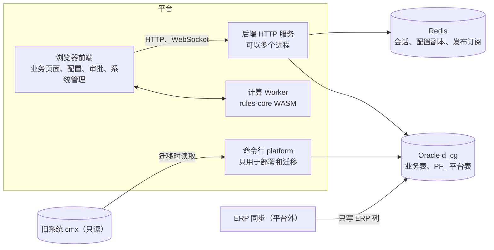
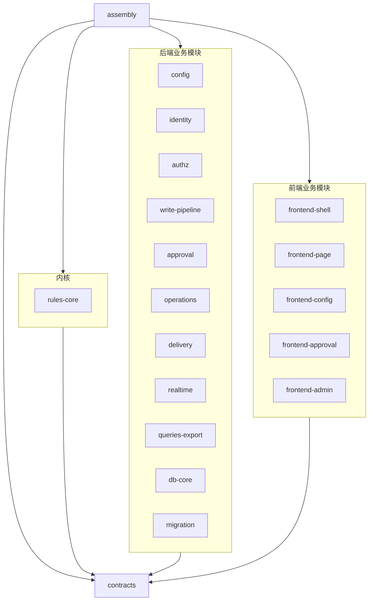
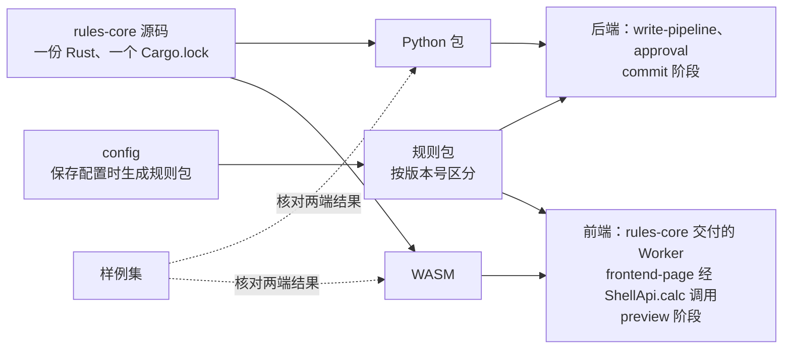

# 架构与组装

状态：已确认。

本文只说明模块组成、依赖方向、组装方式、所有权和跨模块流程。模块的内部设计见各模块说明，接口的字段定义见契约（第 5 节）。

## 1. 系统边界

- 用户的全部操作都在浏览器里完成：查询和保存业务数据、处理审批、编辑和保存配置、管理账号和投递。
- 命令行 `platform` 只用于部署和迁移：建平台表、复制业务表、迁移旧数据、对账。
- 配置保存在数据库里，每个配置项只有当前版本，没有草稿；在前端保存后立即生效。
- ERP 同步在平台之外，只写业务表中的 ERP 列，同步方式不属于平台。业务表由 db-core 从 cmx 一次性复制到 d_cg（DB-03），平台不做持续同步；切换时停机，重新复制一次（migration 的 MG-06）。平台不写 ERP 行的 ERP 列；本地维护的行（例如物料表中 ISERP 不为 1 的行）由平台维护，规则见 C06 第 2 节的 `erpRow`。
- 旧系统（cmx 用户和旧前后端代码）只读，作为迁移来源和行为参照。
- 数据库只支持 Oracle，平台的数据库对象都在 d_cg 用户下。

## 2. 模块清单

| 模块 | 职责 | 代码目录 | 说明 |
|---|---|---|---|
| contracts | 定义模块之间的全部接口、数据结构和错误语义，提供替代实现和契约测试 | `docs/契约/`、`backend/src/cost_platform/contracts/`、`frontend/src/contracts/` | [contracts](模块/contracts.md) |
| rules-core | 用一份 Rust 源码实现计算和规则判断，编出 Python 包和浏览器 WASM | `rules-core/` | [rules-core](模块/rules-core.md) |
| config | 校验并保存前端提交的配置，保存即生效；生成页面视图和规则包，提供配置快照 | `backend/src/cost_platform/config/` | [config](模块/config.md) |
| identity | 登录、选角色、会话、CSRF 校验、账号管理，启动时初始化 admin | `backend/src/cost_platform/identity/` | [identity](模块/identity.md) |
| authz | 判断操作、行和字段权限，把行权限转成查询条件 | `backend/src/cost_platform/authz/` | [authz](模块/authz.md) |
| write-pipeline | 唯一的业务数据写入口：提供命令记录与判重、加锁读取、合并、写入变更和审计的能力（C08 第 5a 节） | `backend/src/cost_platform/pipeline/` | [write-pipeline](模块/write-pipeline.md) |
| orchestration | 编排层：实现 `CommandExecutor`，按操作的 `kind` 取对应的流程，按第 7 节的顺序调用各模块提供的能力；不写业务规则（用户 2026-10-28："模块是用来提供能力的，最终消费这些能力的是另外一个东西"） | `backend/src/cost_platform/orchestration/` | C08 第 5 节 |
| approval | 保存命中审批条件时发起审批，冻结锁定范围内的单据，查找影响对象，保存待审修改，逐级处理和勾选，以及通过、驳回、撤回 | `backend/src/cost_platform/approval/` | [approval](模块/approval.md) |
| operations | 把按钮的通用动作和审批流的动作展开成修改，执行已登记的逃生舱 | `backend/src/cost_platform/operations/` | [operations](模块/operations.md) |
| delivery | 登记、发送和重试通知，维护站内通知 | `backend/src/cost_platform/delivery/` | [delivery](模块/delivery.md) |
| realtime | 维护 WebSocket 连接，把配置变更、通知和会话撤销推给浏览器 | `backend/src/cost_platform/realtime/` | [realtime](模块/realtime.md) |
| queries-export | 列表、按主键取行、单据加载、按键映射或关联 SQL 查找目标、Lookup、字典、个人配置、导出 | `backend/src/cost_platform/queries/` | [queries-export](模块/queries-export.md) |
| db-core | Oracle 连接和事务、十进制读写、错误码映射，以及建平台表、复制业务表、核对表结构 | `backend/src/cost_platform/db_core/` | [db-core](模块/db-core.md) |
| migration | 迁移旧元数据和账号，生成盘点清单，对账，编写切换手册 | `backend/src/cost_platform/migration/` | [migration](模块/migration.md) |
| frontend-shell | 外壳：布局、登录、选角色、菜单、页签、主题；从旧前端复制后清理 | `frontend/src/modules/shell/` | [frontend-shell](模块/frontend-shell.md) |
| frontend-page | 单表页和主从页、原地表单、编辑缓冲、本地预览、保存后局部刷新 | `frontend/src/modules/page/` | [frontend-page](模块/frontend-page.md) |
| frontend-config | 编辑和保存全部配置，包括拖动编辑表单布局 | `frontend/src/modules/config/` | [frontend-config](模块/frontend-config.md) |
| frontend-approval | 待办列表、审批详情和勾选，以及通过、驳回、撤回 | `frontend/src/modules/approval/` | [frontend-approval](模块/frontend-approval.md) |
| frontend-admin | 管理账号、角色分配、部门和投递记录 | `frontend/src/modules/admin/` | [frontend-admin](模块/frontend-admin.md) |
| assembly | 创建各模块的实现并注入依赖，挂载接口，注册管道阶段，启动后台任务，负责联调和端到端验收 | `backend/src/cost_platform/assembly/`、`frontend/src/main.ts`、`frontend/src/assembly/`、`backend/tests/e2e/`、`frontend/tests/e2e/` | [assembly](模块/assembly.md) |

## 3. 依赖规则

1. 业务模块（第 2 节中除 contracts 和 assembly 以外的模块）只依赖 contracts，不导入其他业务模块的代码，也不读写其他模块拥有的表、Redis 键和文件（所有者见第 9 节）。
2. contracts 不依赖任何模块。
3. 只有 assembly 可以依赖业务模块。assembly 只创建实现、注入依赖、挂载接口、注册管道阶段和启动后台任务，不写业务规则。
4. frontend-page 使用 rules-core 的 WASM 构建产物，按 C07 调用，不依赖 rules-core 的源码。
5. 后端用 import-linter、前端用 dependency-cruiser 检查以上规则，违反时构建失败。检查配置归 assembly 维护。

## 4. 前后端共用一套计算

- 选规则、组装输入、计算和解释结果，都只在 rules-core 中实现一次；计算过程中不舍入。后端和前端只写调用包装，不写计算和规则判断。
- 两端加载同一版本的规则包，调用同一组接口（C07）。
- 前端在编辑时按 preview 阶段求值，结果只用于显示计算值、可编辑状态和提示。后端在写入前按 commit 阶段重新求值，写入以后端结果为准，不采用前端的预览值。
- 两端对同一样例集的结果，按 C01 的判定口径必须一致；不一致时停下来问用户。
- 规则需要的数据库数据，由后端查出后作为输入交给 rules-core；rules-core 本身不访问数据库。

## 5. 共享契约

- 定义位置：`docs/契约/` 是契约的唯一定义。`backend/src/cost_platform/contracts/` 和 `frontend/src/contracts/` 中的类型按定义实现，由契约测试核对，不另写定义。
- 维护归属：contracts 模块。修改契约时，先写明改动内容、受影响的模块和任务；用户确认后版本号加一，contracts 同步更新类型、替代实现和契约测试，受影响的模块按新版本适配，assembly 重新联调。任何模块不得复制或另建同类接口。
- 不需要用户确认的改动（用户 2026-10-27："你只需要保证，你实现的功能没问题就行了"，以及不要拿已经交代清楚的事项再问）：能从用户已定规则直接推出的，和只涉及实现细节的（内部数据结构、错误码、并发和死锁处理、主键怎么记），由实施者决定，版本号照样加一，在契约头部写明哪些改动由用户确认、哪些由规则推出、哪些由实施者决定；向用户汇报时，逐条用一句话说明这些改动和依据，用户有异议时按用户的意见改。改变用户看到的业务结果、且已定规则没有覆盖的，仍须用户确认。
- 替代实现：contracts 为第 8 节的每个后端端口和管道阶段提供内存替代实现，为 C09 的每个 HTTP 接口提供前端可用的模拟实现。真实实现必须通过同一套契约测试。

| 编号 | 契约 | 内容 |
|---|---|---|
| C01 | [数据格式](契约/C01-数据格式.md) | 十进制文本、日期时间、行标识（rowKey、clientRowId）、前后端数值一致的判定 |
| C02 | [命令与结果](契约/C02-命令与结果.md) | 请求键、操作、Patch，以及命令结果（受影响行、idMap、提示、审批已提交标记） |
| C03 | [错误](契约/C03-错误.md) | 错误响应体，错误码与 HTTP 状态的对应 |
| C04 | [执行上下文](契约/C04-执行上下文.md) | 身份、选定角色、配置快照和版本号、传播来源 |
| C05 | [页面视图](契约/C05-页面视图.md) | 字段属性、明细 Tab（单表页没有）、按钮、表单布局、规则包引用、审计开关 |
| C06 | [配置模型](契约/C06-配置模型.md) | 实体、页面、字段、操作、规则（JDM）、审批流（审核操作、审批节点、冻结节点、展示数据及其操作）、关联查询、字段映射、传播边界、通知、角色、菜单的数据结构和校验规则 |
| C07 | [规则内核接口](契约/C07-规则内核接口.md) | `load_pack`、`evaluate`、`core_version` 的输入输出 JSON，以及前端 Worker 的消息 |
| C08 | [后端端口](契约/C08-后端端口.md) | 第 8 节所列端口和管道阶段的方法、参数、返回值、错误和事务要求 |
| C09 | [HTTP 接口](契约/C09-HTTP接口.md) | 每个接口的方法、路径、请求、响应、错误和归属模块 |
| C10 | [实时事件](契约/C10-实时事件.md) | Redis 频道消息和 WebSocket 消息 |
| C11 | [前端装载](契约/C11-前端装载.md) | 外壳向前端模块提供什么，前端模块怎样注册路由和菜单 |

## 6. 组装

### 6.1 后端

assembly 的 `create_app(settings)` 按以下顺序执行：

1. 读取 `.env`。`PLATFORM_BACKEND=memory` 时创建 contracts 的内存替代实现，`oracle` 时创建真实实现。
2. 创建 db-core 的连接池和 `UnitOfWork` 工厂、各模块的存储实现，以及 rules-core Python 包提供的 `RulesEngine`。
3. 通过构造参数把端口实现注入各模块，并按第 7 节的顺序把各模块实现的阶段注册进 write-pipeline。模块内部不创建其他模块的实现。
4. 挂载各模块提供的 HTTP 路由（C09）和 `/ws`，注册请求中间件（流程见 10.1）。中间件按 C03 把错误转成响应，并在响应头写 `X-Config-Version`。
5. 调用 config 初始化 `ADMIN` 角色，调用 identity 初始化 admin：没有 admin 时创建 admin / admin123..，已经存在时不改。然后调用 config 的启动预热：按角色加载配置快照、编译全部规则包，完成前不接受业务请求（[config](模块/config.md) CF-13）。最后启动后台任务：delivery 的投递重试、config 的恢复任务、realtime 的 Redis 订阅转发。

命令行 `platform` 使用同一套组装代码，只有两类子命令：`db` 交给 db-core，`migrate` 交给 migration。

### 6.2 前端

assembly 的 `frontend/src/main.ts` 创建按 C09 实现的 HTTP 客户端、按 C10 实现的实时连接，用 rules-core 交付的 `createCalcWorkerClient` 创建计算客户端，加载 frontend-shell，再按 C11 把 frontend-page、frontend-config、frontend-approval 和 frontend-admin 注册到外壳。

### 6.3 协调者与事务

| 范围 | 协调者 | 事务边界 |
|---|---|---|
| 一个 HTTP 请求 | assembly 中间件 | 不开事务；生成执行上下文后交给路由所属模块 |
| 一个命令（保存、按钮、审批处理） | write-pipeline | 一个 Oracle 事务，从判重到写完命令记录；各阶段都在这个事务内执行，不自行提交 |
| 一次配置保存 | config | 一个 Oracle 事务写入当前版本；提交后切换 Redis，再经 realtime 广播 |
| 一次通知发送 | delivery | 每次发送一个事务 |
| 一次账号变更 | identity | 一个 Oracle 事务；提交后使相关会话失效 |
| 查询和导出 | queries-export | 只读，不开写事务 |

## 7. 写入管道的阶段

阶段接口见 C08，orchestration 按下表的顺序执行，不写审批、审计和通知的具体逻辑。各阶段由所属模块实现，由 assembly 注册。页面保存、按钮、审批处理和跨业务操作都只提交命令，任何入口都不单独调用审批、审计或通知。

| 顺序 | 阶段 | 实现模块 | 何时执行 |
|---|---|---|---|
| 1 | 判重 | write-pipeline | 每个命令 |
| 2 | 操作权限 | authz | 每个命令 |
| 3 | 确定涉及的单据 | write-pipeline（页面保存）、operations（按钮操作）、approval（审批处理） | 每个命令 |
| 4 | 按（业务、主键）排序加锁并读取当前数据 | write-pipeline | 每个命令 |
| 5 | 冻结检查 | approval | 涉及可冻结的业务时 |
| 6 | 审批处理 | approval | 通过、驳回、撤回命令 |
| 7 | 按动作顺序展开修改、合并、检查写权限、计算与规则 | operations、write-pipeline、authz、rules-core | 每个动作一轮；后一个动作使用前一个动作计算后的结果 |
| 8 | 触发审批，以及强制审批检查（修改命中必须审批的字段规则却没有进入审批时拒绝） | approval | 触发审批：保存命中审批条件，且执行上下文不带传播来源时；强制审批检查：每个命令 |
| 9 | 写入变更 | write-pipeline | 有实际变化时，只写有变化的列 |
| 10 | 审计 | write-pipeline | 页面开启审计时 |
| 11 | 登记通知 | delivery | 规则或审批产生通知时 |
| 12 | 写入命令记录并提交 | write-pipeline | 每个命令 |
| 13 | 投递 | delivery | 提交后，有投递记录时 |

第 7 步中，动作找到的目标单据不在第 3 步确定的范围内时（例如 `updateRecords` 按关联查询找到的单据），write-pipeline 先对这些单据做第 4、5 步（排序加锁读取、冻结检查），再合并（write-pipeline WP-18）。

新增一类处理时，增加一个阶段并由 assembly 注册，不改其他阶段。

## 8. 跨模块连接

| 端口（C08） | 提供方 | 使用方 |
|---|---|---|
| `UnitOfWork`、`SchemaInspector`、`ConnectionFactory` | db-core | 各模块的存储实现；config 保存配置时核对表和列；migration 读取旧库 |
| `Authenticator` | identity | assembly 中间件、realtime（握手和心跳检查） |
| `DirectoryReader` | identity | approval（审批人和通知接收人） |
| `AccountImporter` | identity | migration |
| `ConfigSnapshotReader` | config | assembly 中间件 |
| `ConfigImporter` | config | migration |
| `CommandExecutor` | orchestration | assembly（`POST /api/commands`）、approval（把通过、驳回、撤回转成命令） |
| `CommandRecorder`、`DocumentStore`、`ChangeMerger` | write-pipeline | orchestration |
| `PipelineStage` | authz、operations、approval、delivery | orchestration（按第 7 节的顺序调用） |
| `PermissionChecker` | authz | write-pipeline（写权限）、queries-export（行权限条件） |
| `RulesEngine` | rules-core | write-pipeline、approval（审批详情）、config（保存配置时编译规则包） |
| `RelatedQuery` | queries-export | operations（按钮的 `updateRecords` 查找目标） |
| `DocumentReader` | queries-export | approval（审批详情） |
| `TableWriter` | write-pipeline | approval（审批通过后写没注册的表） |
| `FreezeReader` | approval | queries-export（标记被冻结的行） |
| `DeliveryDispatcher` | delivery | write-pipeline（提交后投递） |
| `RealtimePublisher` | realtime | config、delivery、identity |
| `PersonalConfigImporter` | queries-export | migration |
| HTTP 接口（C09） | 各后端模块 | 各前端模块 |
| 计算客户端 `CalcWorkerClient`（C07 第 5 节、C11），含 Worker 脚本和 WASM | rules-core | assembly 创建实例；frontend-page 经 `ShellApi.calc` 使用 |
| 前端装载（C11） | frontend-shell | frontend-page、frontend-config、frontend-approval、frontend-admin |

每条连接的接入责任：

- 提供方：实现端口，通过 contracts 的契约测试。
- 使用方：用 contracts 的替代实现开发和验收本模块，结果记为"模拟验证"。
- assembly：接上真实实现并联调，结果记为"真实联调"。联调发现的问题按契约判定：偏离契约的一方修改；契约本身不足时按第 5 节修改契约。

## 9. 所有权

| 对象 | 所有者 | 其他模块的访问方式 |
|---|---|---|
| 业务表中平台自有的列 | write-pipeline | 只有 write-pipeline 写入，其他模块经 orchestration 的 `CommandExecutor` 提交修改；queries-export 只读。唯一例外：用户点名启用的逃生舱由 operations 在 write-pipeline 的命令事务内执行 |
| 业务表中 ERP 行的 ERP 列 | 平台外的 ERP 同步 | 平台只读；本地行的这些列按上一行归 write-pipeline |
| 业务表结构（从 cmx 复制） | db-core | 复制时只取页面显示的列，虚拟列改为普通列（DB-03） |
| 命令记录和审计差异 | write-pipeline | 其他模块不读写 |
| 命令审查记录（Redis，只在开启时记录，关闭即清除） | write-pipeline | frontend-admin 经 C09 第 7a 节查看和开关 |
| 配置（每个配置项的当前内容和版本号，包括角色及其权限）、Redis 配置键、进程内配置缓存 | config | 经 `ConfigSnapshotReader` 读取；frontend-config 经 C09 编辑 |
| 账号、账号的角色分配、部门，Redis 会话键 | identity | 经 `Authenticator`、`DirectoryReader` 读取；frontend-admin 经 C09 管理 |
| 审批实例、处理记录、待审修改、影响对象的行和勾选结果、冻结记录 | approval | 经 approval 实现的管道阶段使用；queries-export 经 `FreezeReader` 读取冻结记录 |
| 投递记录、站内通知 | delivery | 经 delivery 实现的管道阶段登记；frontend-admin 经 C09 查看和重新排队 |
| 个人列配置 | queries-export | migration 经 `PersonalConfigImporter` 写入 |
| Redis 发布订阅频道、WebSocket 连接登记 | realtime | 经 `RealtimePublisher` 发布 |
| 规则包 | config 生成 | rules-core 解释；前端经 C09 下载 |
| 编辑缓冲和页面状态 | frontend-page | 不跨模块共享 |
| 配置编辑界面的状态 | frontend-config | 不跨模块共享 |
| 待办和审批详情的界面状态 | frontend-approval | 不跨模块共享 |

事务的所有者见 6.3。

## 10. 关键流程

### 10.1 请求进入

1. assembly 中间件调用 identity 的 `Authenticator` 校验会话 Cookie；写请求还要校验 `X-CSRF-Token`。校验不通过时按 C03 返回 401 或 403，不调用业务模块。
2. 中间件调用 config 的 `ConfigSnapshotReader`，按选定角色读取本请求用到的配置版本。配置不可用时返回 503 CONFIG_UNAVAILABLE。
3. 中间件生成执行上下文（C04），交给路由所属模块。同一请求内上下文不变。

### 10.2 保存和按钮操作

提交边界：第 7 节的第 1 到第 12 阶段在一个 Oracle 事务内；第 13 阶段在提交之后。

1. frontend-page 把整页置为只读，按 C02 调用 `POST /api/commands`。
2. orchestration 按第 7 节执行各阶段，调用 write-pipeline 等模块的能力。同一请求键已有结果时，判重阶段直接返回原结果，不执行后续阶段。
3. frontend-page 按命令结果逐行比对后局部刷新，恢复编辑。

失败处理：

- 提交前任一阶段失败，整个事务回滚，业务数据、审批数据、投递记录和命令记录都不保留，错误按 C03 返回。
- frontend-page 收到错误或没有收到响应时，结束只读并保留修改，不自动重发；再次保存由用户发起。

### 10.3 保存触发审批

审批没有单独的送审按钮。保存的那一刻，来源单据和冻结节点找到的数据在同一个事务中被冻结。驳回和撤回照常记录处理人、原因和审批状态，并解除冻结；它们只是不让待审修改生效，也不执行操作。必须全部审批节点都通过，修改才生效：审批中途任何一级通过都不写业务表（approval AP-20）。审批流的配置见 C06 第 7 节。

1. 计算与规则阶段照常计算；审批不经过 rules-core。
2. approval 的触发审批阶段按单据判断：主从页每张单据（一行主表及其明细）、单表页每一行。对本页面的每个启用审批流，取审核操作选中的表格里做了选中操作的行，逐行代入第 1 级节点的入口条件（带 `:new_`、`:old_` 等参数的 SQL 片段，approval 经 `UnitOfWork` 执行）；成立的行是触发本审批的行。第 1 级有节点进入的审批流都进入这张单据的审批；一个都没有时，这张单据按普通保存写入；但修改命中实体的必须审批规则时，拒绝保存（409 APPROVAL_REQUIRED，[approval](模块/approval.md) AP-18）。提交审批的单据整张冻结，本次对它的全部修改都随审批等待；同一命令中其余单据照常写入（[approval](模块/approval.md) AP-01）。
3. 进入审批时，approval 在命令事务内为每个审批完成以下登记，write-pipeline 不写这些单据：
   - 冻结：触发审批的单据总是整单冻结；冻结节点的每一项，对每个触发行执行关联条件，查到的行，表在平台注册过的冻结它所属的整张单据，没注册的冻结这一行（C06 7.4）。冻结表只能是表，不能是视图。冻结记录按（根表、主键）登记，内容为所属审批。同一份数据同一时间只属于一个未结束的审批，没有排队：要冻结的数据已被别的审批冻结时，整个命令返回 409 FROZEN_BY_APPROVAL（[approval](模块/approval.md) AP-06）。
   - 查找受影响单据：展示数据中每个受影响单据的块，对每个触发行执行关联条件，结果按修改表的主键合并，记下这些行和找到它们的触发行，默认都勾选（C06 7.5）。查询本身只读，冻不冻结只看冻结节点。同一条记录要被写成两个值时，拒绝保存（AP-22）。
   - 保存待审修改，登记给一级审批人的通知。
4. 命令结果列出提交的审批，这些单据被修改的字段保持原值。frontend-page 显示待审批状态，被冻结的单据只读，用户试图修改时弹出冻结它的审批的进度（frontend-page FP-16）。被冻结的单据，主表和明细的修改、新增和删除都由后端的冻结检查阶段拒绝，不只靠前端只读。
5. 冻结节点和展示数据分开配置：冻结防止审批期间数据被其他操作改变，勾选决定通过后实际修改受影响单据的哪些行。没有被写到的冻结数据，审批结束时解冻，内容不变；被写到的照常修改（C06 7.4、7.5）。
6. 一张单据命中多个审批流时，各审批流的同一级合在一起审批：同一个人在本级多个节点中只需通过一次，不同级别要分别通过；各审批流分别决定终点（approval AP-04、AP-09、AP-16）。全部审批流到达终点后修改才生效；任何节点被驳回或审批被撤回，这张单据的修改都不生效，并解除本审批的全部冻结。

### 10.4 审批处理

提交边界：一次处理是一个命令，事务范围与 10.2 相同。

1. frontend-approval 调用 approval 的处理接口（C09）。approval 把处理转成命令，交给 orchestration 的 `CommandExecutor`。
2. 在审批处理阶段，approval 判断这次处理能否执行，记录处理人、处理结果和勾选的行（只能从 `selection` 为 `checked` 的块中上一级保留的行里选），并判断去向：留在本级、进入下一级，或到达终点。
3. 审批到达终点时，同一命令依次执行（C06 7.7、approval AP-10）：
   - 把待审修改应用到来源单据，按来源的计算规则重算；
   - 按审批流的 `order` 和块的顺序，对每块勾选的行执行通过后的操作：修改表注册过的，approval 把操作展开为 intents，由 write-pipeline 加锁、做冻结检查、合并、按这一行所属页面的计算和校验规则重算后写入；没注册的，经 write-pipeline 的 `TableWriter` 按主键直接写，不重算。取消勾选的行不修改；全部取消，或者没有受影响单据时，只让来源修改生效；
   - 写入不按某个人的权限；计算字段和只读的 ERP 列不可写；只写实际变化。
4. 这些写入的执行上下文带有本审批的传播来源（C04），不再触发审批，处理到目标为止。
5. approval 更新审批状态，记录本次实际修改的数据和执行结果，解除本审批的冻结；delivery 登记通知。
6. write-pipeline 写入命令记录和审计，提交事务，提交后投递。

失败处理：任一步失败都整笔回滚，审批保持处理前的状态，不会只改成功一半。重复提交同一请求键时返回原结果，不重复执行。驳回和撤回在一个事务中写处理记录和原因、改审批状态、把待审修改标为作废，解除本审批的冻结，并登记通知；待审修改不写进业务表。

### 10.5 打开审批详情

approval 读取本审批受影响单据的行和勾选结果，经 queries-export 的 `DocumentReader` 读取来源单据和受影响单据的当前数据，合并待审修改和勾选的行要写的值后调用 rules-core，算出修改前后的值（C06 7.6）。审批人改了勾选时，前端调用 `preview`，按新的勾选再算一遍（C09 第 6 节）。展示哪些列由审批流配置决定。这一流程只读，不加锁，不开写事务。

### 10.6 配置保存与实时生效

提交边界：第 2 步是一个 Oracle 事务，提交即生效；第 3 步和第 4 步在提交之后，失败或进程退出时由恢复机制补齐（[config](模块/config.md) CF-04、CF-05）。

1. frontend-config 调用 config 的保存接口（C09）。config 按 C06 校验：引用和字段映射有效；关联 SQL 只含一条查询语句，参数用绑定变量，结果包含目标的实体、主单主键和明细主键；规则只用白名单节点。config 还调用 db-core 的 `SchemaInspector` 核对表和列，调用 rules-core 编译规则包。任一项不通过时拒绝保存，当前版本不变。
2. config 锁定配置代号，在 Redis 中登记待生效，然后在同一个 Oracle 事务内写入新内容、代号加一，提交。
3. config 写入 Redis，原子切换到新代号，并删除待生效登记。在这之前，读取配置快照的请求如果看到待生效登记，会查一次 Oracle，用已提交的新配置；恢复任务负责补写 Redis。已提交的保存不回滚。
4. config 调用 realtime 发布配置变更事件（C10），realtime 推给打开了相关页面的连接，frontend-page 重新读取页面视图并原地替换。正在执行的命令继续使用开始时的配置快照；已经发起的审批不受审批流配置修改的影响（[C06](契约/C06-配置模型.md) 7.1）。

### 10.7 登录、账号变更与会话撤销

1. frontend-shell 调用 identity 的登录和选角色接口（C09），identity 校验密码并写入会话。
2. 管理员在 frontend-admin 中停用账号或撤销角色。identity 在一个事务内更新账号，提交后让该账号的会话立即失效，并调用 realtime 推送会话撤销事件。
3. frontend-shell 收到会话撤销事件或 401 响应时回到登录页。

### 10.8 通知投递

1. 投递记录在命令事务内登记（第 7 节第 11 阶段）。
2. 提交后 delivery 立即发送：写入站内通知，调用 realtime 推送。每次发送在 delivery 自己的事务内更新投递状态。
3. 发送失败时按退避间隔重试，超过次数标为放弃；管理员可以在 frontend-admin 中查看并重新排队。发送失败不撤销已提交的业务。

### 10.9 查询与导出

queries-export 读取执行上下文中的页面视图，调用 authz 生成行权限条件，经 db-core 查询。这一流程只读，不开写事务。

### 10.10 部署与迁移

1. `platform db`：db-core 建平台表，从 cmx 复制业务表，核对表结构。
2. `platform migrate`：migration 经 db-core 的 `ConnectionFactory` 只读连接 cmx，读取旧元数据，生成配置和盘点清单，交用户确认。
3. 用户确认后，migration 经 config 的 `ConfigImporter` 写入配置（与前端保存使用同一套校验），经 identity 的 `AccountImporter` 导入账号、角色和部门，经 queries-export 的 `PersonalConfigImporter` 导入个人列配置。
4. migration 调用 rules-core，按迁移后的配置重算真实单据，与业务表中的现有值对账。
5. 按 migration 的切换手册执行切换。

## 11. 开发顺序与并行分组

| 组 | 模块 | 开始开发的前置条件 | 完成验收的前置条件 |
|---|---|---|---|
| 0 | contracts，以及 assembly 的工程骨架（T-AS-1）、frontend-shell 的复制与清理（T-FS-1） | contracts：本文和 C01 到 C11 经用户确认；T-AS-1、T-FS-1 可以最先开始 | 替代实现和契约测试可以运行；T-AS-1、T-FS-1 通过各自的验收 |
| 1 | 第 2 节中除 contracts 和 assembly 以外的全部模块，彼此并行 | 第 0 组完成；各模块另有的前置条件见其模块说明 | 通过契约测试，完成模拟验证；真实联调在第 2 组完成 |
| 2 | assembly | 参与本批联调的模块已完成模拟验证 | 下表各批联调和端到端验证全部通过 |

第 1 组开始后尽早跑通一条真实业务链（批次 0，[T-AS-9](任务/assembly.md)），不等各模块的模拟验证全部完成。第 2 组按批次接入，每批在上一批通过后开始：

| 批次 | 新接入的模块 | 验证的流程 |
|---|---|---|
| 0 | 各模块的最小部分，见 T-AS-9 | 业务例子 E01：浏览器保存、写入管道、Oracle 提交、回读 |
| A | db-core、identity、config、realtime | 10.1、10.6、10.7，经 HTTP 接口验证 |
| B | authz、rules-core、write-pipeline、operations、delivery、queries-export | 10.2、10.8、10.9 |
| C | approval | 10.3 到 10.5，并用 approval 模块说明中的审批场景验证 |
| D | frontend-shell、frontend-page、frontend-config、frontend-approval、frontend-admin | 10.1 到 10.9，从浏览器到数据库 |
| E | migration | 10.10，用真实旧数据迁移、对账和切换演练 |

rules-core 在第 1 组中先做可行性验证。验证完成前，依赖它的模块用 `RulesEngine` 的替代实现开发；验证不通过时停下来问用户。

